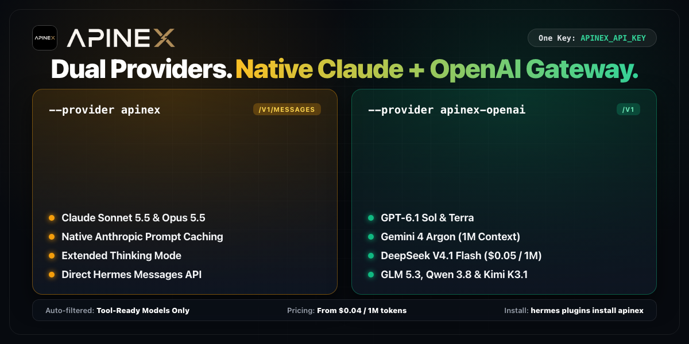
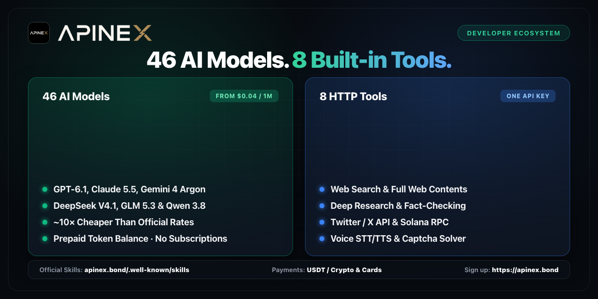

# hermes-provider-apinex

APInex model providers for [Hermes Agent](https://github.com/NousResearch/hermes-agent).

[APInex](https://apinex.bond/?utm_source=hermes&utm_medium=plugin) is a unified AI API gateway: one `sk-apx-...` API key for Claude 5.5, GPT-6.1, Gemini 4 Argon, DeepSeek V4.1, Qwen 3.8, GLM 5.3, Kimi K3.1, Grok 4.7, **19 Free-tier chat models (`$0.00/1M`)**, and 8 built-in Agent HTTP tools (Web Search, Web Contents, Deep Research, Twitter/X Read API, Solana RPC, Captcha Solver, Translator, Voice STT/TTS). Top up with USDT / crypto or card — no foreign bank card or VPN required.

Hermes speaks one wire protocol per provider, so this plugin registers two providers on the same `APINEX_API_KEY`:

| Provider | Models | Wire protocol | Endpoint |
|---|---|---|---|
| `apinex` | Claude (`claude-*`, `free/claude-*`) | Native Anthropic Messages API | `https://api.apinex.bond/v1/messages` |
| `apinex-openai` | GPT, Gemini, DeepSeek, GLM, Qwen, Kimi, Grok and Free-tier chat models | OpenAI-compatible Chat Completions | `https://api.apinex.bond/v1` |

Claude runs over the native Anthropic Messages protocol so Hermes applies Anthropic prompt caching (`cache_control` breakpoints) and extended thinking (`agent.reasoning_effort`) exactly as it does for Anthropic directly.

The plugin registers these two model providers and nothing else: no tools, hooks, middleware, commands, background threads or processes. Hermes core files are not touched.

Maintained by [APInex](https://apinex.bond/?utm_source=hermes&utm_medium=plugin).

---

**По-русски.** Плагин добавляет [APInex](https://apinex.bond/ru?utm_source=hermes&utm_medium=plugin) в Hermes как два провайдера на одном ключе `APINEX_API_KEY`: `apinex` (модели Claude через нативный Anthropic Messages API с поддержкой prompt caching и thinking) и `apinex-openai` (GPT-6.1, Gemini 4 Argon, DeepSeek V4.1, GLM 5.3, Qwen 3.8, Kimi K3.1, Grok 4.7 и 17 бесплатных моделей `free/*` за `$0.00/1M` через OpenAI-совместимый API). Работает из России и СНГ без VPN, пополнение баланса в USDT / крипте без зарубежной банковской карты, при регистрации начисляются бесплатные токены. Документация на русском: [apinex.bond/ru/integrations/hermes](https://apinex.bond/ru/integrations/hermes?utm_source=hermes&utm_medium=plugin).

**简体中文。** 本插件将 [APInex](https://apinex.bond/zh?utm_source=hermes&utm_medium=plugin) 作为两个模型提供商添加到 Hermes，共用同一个 `APINEX_API_KEY`：`apinex` 通过原生 Anthropic Messages API（`/v1/messages`）运行 Claude 5.5 与免费 `free/claude-*` 模型（原生支持 Prompt Caching 缓存断点与深度思考）；`apinex-openai` 通过 OpenAI 兼容接口（`/v1/chat/completions`）运行 GPT-6.1、Gemini 4 Argon、DeepSeek V4.1、Qwen 3.8、GLM 5.3、Kimi K3.1、Grok 4.7 及 17 款 `$0.00/1M` 免费模型。支持 USDT 充值、免绑海外信用卡、国内直连免翻墙。中文集成指南：[apinex.bond/zh/integrations/hermes](https://apinex.bond/zh/integrations/hermes?utm_source=hermes&utm_medium=plugin)。

---

## What you get



- `--provider apinex` and `--provider apinex-openai`, both providers in `hermes model` and `/model`, `hermes setup` and `hermes doctor` checks, all wired automatically by Hermes from the provider profiles.
- `/model` pickers built from your account's live model list (`GET https://api.apinex.bond/v1/models`):
  - **5 Claude models** under `apinex` (`claude-sonnet-5.5`, `claude-opus-5.5`, `claude-fable-5.1`, `free/claude-sonnet-4.6`, `free/claude-opus-4.6`).
  - **34 tool-capable chat models** under `apinex-openai` (including 17 `free/*` models at `$0.00/1M`).
  - Non-tool models (`drex-v2.0`, `jev-1.13`, `free/jev-1.13`) and image/video/audio/embedding endpoints are filtered out so Hermes never selects a route without tool calling.
- Context windows (`1,000,000` tokens across Claude, GPT, Gemini, DeepSeek, GLM, Qwen, Kimi; `500,000` on `grok-4.7`) and native image input (`supports_vision`) declared per model so Hermes does not fall back to generic defaults.
- Zero-cost auxiliary models for Hermes background tasks (context compression, session titles): `free/claude-sonnet-4.6` on `apinex` and `free/deepseek-v4.1-flash` on `apinex-openai`.

### Why use the plugin instead of a manual `custom_providers` entry?

| Feature | Manual `custom_providers` in `config.yaml` | `hermes-provider-apinex` plugin |
|---|---|---|
| Setup | Edit YAML manually, set `context_length`, list model IDs by hand | `hermes plugins install apinex` |
| Claude wire protocol | Forced onto `/v1/chat/completions` (no Anthropic prompt-cache breakpoints) | Native `/v1/messages` on `apinex` with automatic prompt caching & thinking |
| `/model` picker | Unfiltered list (includes non-tool models like `drex-v2.0` / `jev-1.13`) | Filtered to the 39 tool-capable chat models |
| Context windows & vision | Single static `context_length` override | Per-model `1M` / `500K` context & `supports_vision` metadata |
| Background compression model | Uses your paid main model unless configured | Defaults to `$0.00/1M` `free/claude-sonnet-4.6` / `free/deepseek-v4.1-flash` |

---

## Requirements

- Hermes Agent `0.21.5` or newer. The `apinex` provider uses Hermes' Anthropic transport, which needs the `anthropic` Python package; Hermes installs it on first use (or ships it with its `anthropic` extra).
- An APInex API key in `APINEX_API_KEY`. Create an account at [apinex.bond/register](https://apinex.bond/register?utm_source=hermes&utm_medium=plugin) (includes free trial tokens, no credit card required) and copy your `sk-apx-...` key from the dashboard.
- The plugin itself has no Python dependencies beyond the standard library.

---

## Install

From the Hermes plugin catalog:

```bash
hermes plugins install apinex
```

Or install directly from GitHub into your Hermes home:

```bash
git clone https://github.com/Apinex-AI/hermes-provider-apinex.git
mkdir -p ~/.hermes/plugins/model-providers
cp -r hermes-provider-apinex/apinex ~/.hermes/plugins/model-providers/apinex
```

---

## Use

Set `APINEX_API_KEY` in your shell or in `~/.hermes/.env`:

```bash
export APINEX_API_KEY="sk-apx-..."

# Native Anthropic Messages API (Claude 5.5 + free/claude-*)
hermes --provider apinex --model claude-sonnet-5.5

# OpenAI-compatible API (GPT-6.1, Gemini 4 Argon, DeepSeek V4.1, Free tier)
hermes --provider apinex-openai --model free/deepseek-v4.1-flash
hermes --provider apinex-openai --model gpt-6.1-sol
```

Or run `hermes model`, select **APInex** or **APInex (OpenAI-compatible)**, and pick a model interactively.

In `~/.hermes/config.yaml`:

```yaml
model:
  provider: apinex
  default: claude-sonnet-5.5
```

Or for the OpenAI-compatible side:

```yaml
model:
  provider: apinex-openai
  default: free/deepseek-v4.1-flash
```

---

## Supported models & pricing snapshot

Full live catalog and benchmarks: [apinex.bond/models](https://apinex.bond/models?utm_source=hermes&utm_medium=plugin) and [apinex.bond/pricing](https://apinex.bond/pricing?utm_source=hermes&utm_medium=plugin).

### `apinex` — Native Anthropic Messages API (`https://api.apinex.bond/v1/messages`)

| Model ID | Context | Vision | Tool Calling | Input / 1M | Output / 1M |
|---|---|---|---|---|---|
| `claude-sonnet-5.5` | 1,000,000 | Yes | Yes | `$0.40` | `$0.40` |
| `claude-opus-5.5` | 1,000,000 | Yes | Yes | `$0.50` | `$0.50` |
| `claude-fable-5.1` | 1,000,000 | Yes | Yes | `$2.00` | `$2.00` |
| `free/claude-sonnet-4.6` | 1,000,000 | Yes | Yes | `$0.00` | `$0.00` |
| `free/claude-opus-4.6` | 1,000,000 | Yes | Yes | `$0.00` | `$0.00` |

### `apinex-openai` — OpenAI-compatible API (`https://api.apinex.bond/v1`)

| Model ID | Family | Context | Vision | Input / 1M | Output / 1M |
|---|---|---|---|---|---|
| `free/deepseek-v4.1-flash` | DeepSeek | 1,000,000 | Yes | `$0.00` | `$0.00` |
| `free/glm-5.3-flash` | GLM | 1,000,000 | Yes | `$0.00` | `$0.00` |
| `free/qwen-3.8-max` | Qwen | 1,000,000 | Yes | `$0.00` | `$0.00` |
| `free/gemini-3.8-flash` | Gemini | 1,000,000 | Yes | `$0.00` | `$0.00` |
| `free/gemini-3.1-pro` | Gemini | 1,000,000 | Yes | `$0.00` | `$0.00` |
| `free/gpt-6-luna` | GPT | 1,000,000 | Yes | `$0.00` | `$0.00` |
| `free/kimi-k3` | Kimi | 1,000,000 | Yes | `$0.00` | `$0.00` |
| `free/minimax-m3.1-flash` | MiniMax | 1,000,000 | Yes | `$0.00` | `$0.00` |
| `gpt-6.1-sol` | GPT | 1,000,000 | Yes | `$0.30` | `$0.30` |
| `gpt-6.1-terra` | GPT | 1,000,000 | Yes | `$0.17` | `$0.17` |
| `gpt-6-astra` | GPT | 1,000,000 | Yes | `$0.50` | `$0.50` |
| `gpt-6-luna` | GPT | 1,000,000 | Yes | `$0.075` | `$0.075` |
| `gemini-4-argon` | Gemini | 1,000,000 | Yes | `$0.60` | `$0.60` |
| `gemini-3.1-pro` | Gemini | 1,000,000 | Yes | `$0.15` | `$0.15` |
| `gemini-3.8-flash` | Gemini | 1,000,000 | Yes | `$0.10` | `$0.10` |
| `deepseek-v4.1-flash` | DeepSeek | 1,000,000 | Yes | `$0.06` | `$0.06` |
| `deepseek-v4-pro` | DeepSeek | 1,000,000 | No | `$0.07` | `$0.07` |
| `deepseek-v4-flash` | DeepSeek | 1,000,000 | No | `$0.05` | `$0.05` |
| `glm-5.3-flash` | GLM | 1,000,000 | Yes | `$0.05` | `$0.05` |
| `glm-5.3` | GLM | 1,000,000 | No | `$0.15` | `$0.15` |
| `kimi-k3.1-pro` | Kimi | 1,000,000 | Yes | `$0.30` | `$0.40` |
| `grok-4.7` | Grok | 500,000 | Yes | `$0.30` | `$0.30` |
| `muse-spark-1.3` | Muse | 1,000,000 | Yes | `$0.30` | `$0.30` |
| `hy4-preview` | Hunyuan | 1,000,000 | Yes | `$0.30` | `$0.30` |

Plus 9 additional `free/*` routes (`free/deepseek-v4-flash-0731`, `free/deepseek-v4-pro-0813`, `free/glm-5.3`, `free/glm-5.3-flashx`, `free/hy4`, `free/kimi-k2.8`, `free/mimo-v2.6-flash`, `free/mimo-v2.6-pro`, `free/minimax-m3`, `free/muse-spark-1.3`).

---

## Companion APInex skills & ecosystem for Hermes



Your `APINEX_API_KEY` also unlocks 8 HTTP agent tools on `https://api.apinex.bond/v1/tools/*`. You can discover and install the official APInex workflow skills directly in Hermes via `well-known`:

```bash
hermes skills search https://apinex.bond --source well-known
```

Install any skill with one command:

```bash
hermes skills install well-known:https://apinex.bond/.well-known/skills/apinex-quickstart
hermes skills install well-known:https://apinex.bond/.well-known/skills/apinex-cli
hermes skills install well-known:https://apinex.bond/.well-known/skills/apinex-web-search
hermes skills install well-known:https://apinex.bond/.well-known/skills/apinex-twitter-api
hermes skills install well-known:https://apinex.bond/.well-known/skills/apinex-solana-captcha-voice
hermes skills install well-known:https://apinex.bond/.well-known/skills/apinexgate-reseller
```

- **APInex CLI (`apinex-cli`):** configure Hermes, Claude Code, Cursor, Codex, OpenCode and Cline with a single login — see [apinex.bond/cli](https://apinex.bond/cli?utm_source=hermes&utm_medium=plugin) or [github.com/Apinex-AI/APInex-CLI](https://github.com/Apinex-AI/APInex-CLI).
- **APInexGate White-Label Storefront:** launch your own branded AI API reseller portal backed by your APInex master key — see [apinex.bond/resell](https://apinex.bond/resell?utm_source=hermes&utm_medium=plugin) or [github.com/Apinex-AI/APInexGate](https://github.com/Apinex-AI/APInexGate).
- **Developer documentation:** [apinex.bond/developers](https://apinex.bond/developers?utm_source=hermes&utm_medium=plugin).

---

## Security, privacy and footprint

- **Two provider profiles only.** Importing `apinex` calls `register_provider()` twice (`apinex` and `apinex-openai`). It registers no tools, hooks, middleware, slash commands, CLI subcommands, background threads or child processes.
- **Network.** The plugin makes no network requests of its own. Model listing uses Hermes' `ProviderProfile.fetch_models()`, which sends `GET https://api.apinex.bond/v1/models` with `Authorization: Bearer $APINEX_API_KEY`. Chat requests are sent by Hermes' own Anthropic and OpenAI clients to `https://api.apinex.bond/v1/messages` (for `apinex`) and `https://api.apinex.bond/v1/chat/completions` (for `apinex-openai`), which forward each request to the upstream model provider. If you set `model.base_url` to another host, requests go to that host instead.
- **Credentials and files.** Hermes reads `APINEX_API_KEY` from your environment or `~/.hermes/.env` and passes it to its clients. The plugin never reads, writes, logs, caches or stores the key or any local files.
- **No extra headers or telemetry.** `default_headers` is empty (`{}`). No analytics, telemetry or crash reports are sent.
- **Terms & privacy:** [apinex.bond/privacy](https://apinex.bond/privacy?utm_source=hermes&utm_medium=plugin) and [apinex.bond/terms](https://apinex.bond/terms?utm_source=hermes&utm_medium=plugin).

---

## Tests

Offline unit and packaging tests (standard library only, no Hermes checkout or network required):

```bash
python3 -m unittest discover -s tests -v
```

---

## Changelog

### 0.1.0

- Initial release: `apinex` (native Anthropic Messages API) and `apinex-openai` (OpenAI-compatible Chat Completions) providers on a single `APINEX_API_KEY`, with per-model context windows and vision capabilities for all 39 tool-capable APInex chat models.
